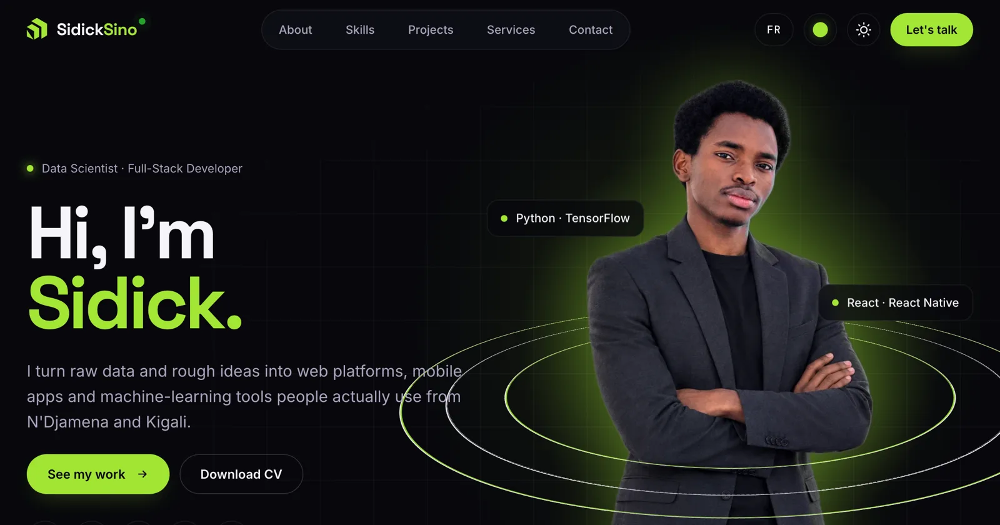

# Sidick Sino — Portfolio

Personal portfolio of **Sidick Abdoulaye Hissein** — Data Scientist and
Full-Stack Developer based between N'Djamena, Chad and Kigali, Rwanda.

**Live:** <https://www.sidickabdoulaye.com>



A bilingual (English / French) single-page site — one continuous scroll from
hero to contact — with dark and light themes and a visitor-selectable brand
colour. It features shipped projects across web, mobile, design and machine
learning.

**Sections, in order:** Hero (3D rings orbiting the portrait, with a scan lens
on hover) → About (stacking story cards) → Where I build from (wireframe globe)
→ Skills → Work (filterable project grid) → Services → Contact → Footer.

---

## Stack

| | |
|---|---|
| **Framework** | React 19 + Vite 8 (Rolldown) |
| **Routing** | React Router 7 |
| **i18n** | i18next / react-i18next — English + French |
| **Styling** | Hand-written CSS with a design-token system, Tailwind v4 available |
| **Type** | Space Grotesk (display), Inter (body), JetBrains Mono (labels) |
| **Motion** | Framer Motion, GSAP (ScrollTrigger) |
| **Forms** | EmailJS + SweetAlert2 |
| **SEO** | React 19 native document metadata, generated sitemap, robots.txt, hreflang (en/fr) |
| **Hosting** | Vercel |

## Running it

Requires Node 18+.

```bash
npm install     # postinstall scripts must be approved — see note below
npm run dev     # http://localhost:5173
```

| Script | Does |
|---|---|
| `npm run dev` | Dev server with HMR |
| `npm run build` | Production build to `dist/` (regenerates `sitemap.xml` first) |
| `npm run preview` | Serve the production build locally |
| `npm run lint` | ESLint |

> **On `npm install`:** this project pins `legacy-peer-deps=true` in `.npmrc`,
> and `package.json` carries an `allowScripts` block for `esbuild`,
> `@tailwindcss/oxide` and `fsevents`. Those postinstall scripts unpack native
> binaries — **the build fails without them**, so keep that block.

## Layout

```
src/
├─ index.css              ← design tokens. The single source of truth.
├─ i18n.js                ← i18next setup; also keeps <html lang> in sync
├─ App.jsx                ← routes
├─ data/
│  ├─ projectData.js      ← projects (baked in from the API at build time)
│  └─ siteData.js         ← skills, services and social links
├─ locales/               ← en.json / fr.json (keys must stay in parity)
└─ components/
   ├─ hero/  about/  where/  skills/  ← homepage sections, in page order
   ├─ featured/                       ← the Work grid with category filters
   ├─ services/  contact/  footer/  navbar/
   ├─ AccentPicker.jsx                ← the colour switcher in the navbar
   └─ common/                         ← <Reveal>, <LogoMark>, icons
```

### Three conventions worth knowing

**All design tokens live in `src/index.css`.** No other stylesheet may declare
`:root`. Colours, spacing, type and radii are tokens — component CSS consumes
them and never hard-codes a hex value. **The brand colour is one line**
(`--accent`); every other accent shade is derived from it. Visitors can switch
between the tested colours from the navbar — that list lives in
`src/components/theme/accents.js` (and in a small script in `index.html`).

**One page, no sub-pages.** The old `/projects/*` and `/pages/hero` URLs still
work: a category URL opens the Work grid with that filter, `/pages/hero` lands
on About.

**Content is data, not markup.** Projects come from the admin dashboard
(`/admin`) and are fetched at build time; skills and services are defined in
`src/data/`, and every user-facing string is a key in `src/locales/`. To change
what Work shows under "Featured", toggle `featured` on a project in the
dashboard.

**Nothing that changes over time is typed by hand.** Project counts come from
`totalProjectCount`, the copyright year from `getFullYear()`, and
`sitemap.xml`'s `lastmod` from `scripts/generate-sitemap.mjs` at build time.
Marketing copy avoids counts entirely — a description that says "19 projects"
is wrong the day you ship the twentieth.

**Photos are never regenerated by AI.** Image generators changed the face
every time they were tried. Real photos are only edited (colour, light) or cut
out with a background-removal model.

## Contributing to this repo

- `plan.md` tracks the ongoing improvement work, phase by phase, with what was
  measured and why.
- `.claude/skills/portfolio-design/` holds the design system rules — read it
  before changing anything visual.
- Verify changes by **running the site and looking at it**, in both themes and
  at 390px, not just by reading the CSS. Several bugs here were invisible in the
  source and obvious in the browser.

## Licence

No licence granted. The code is public for reference; the content, images and
personal branding are not free to reuse.
